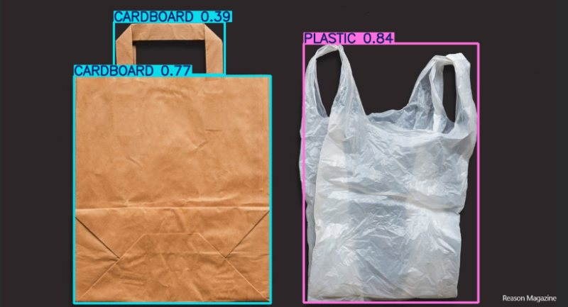
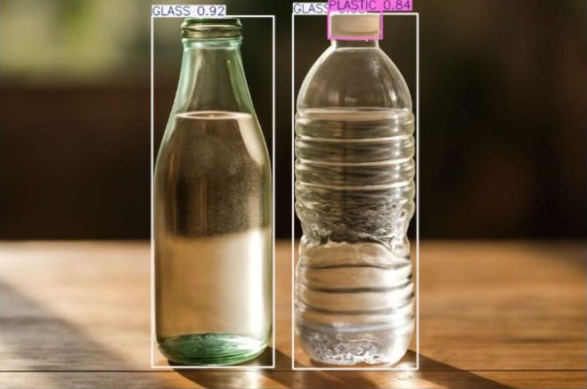
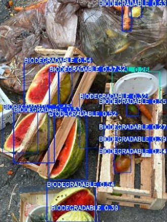
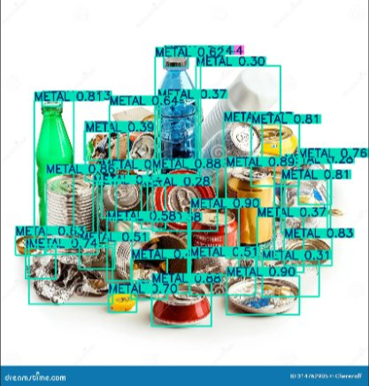
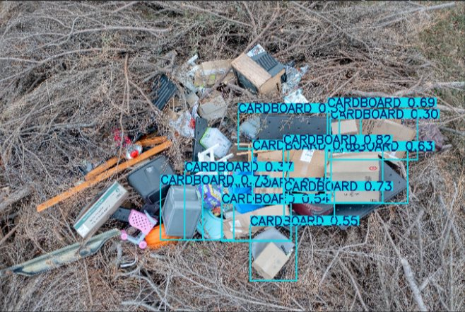
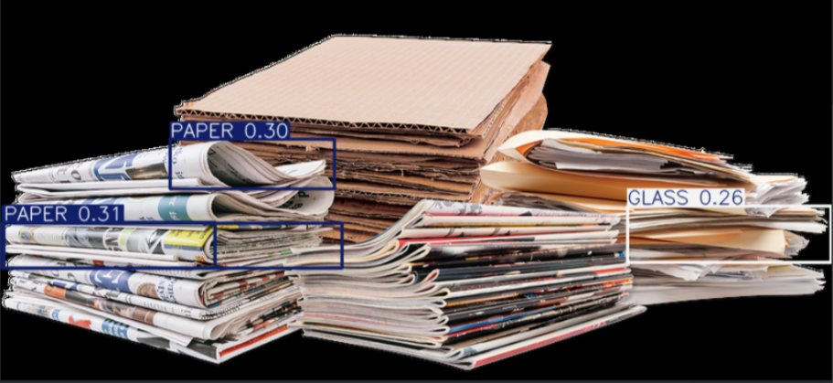
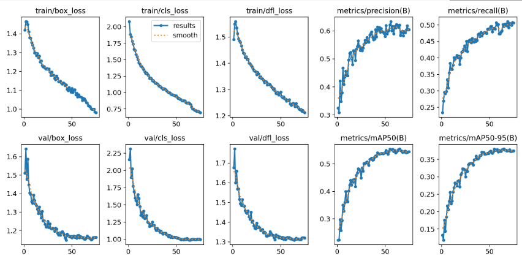
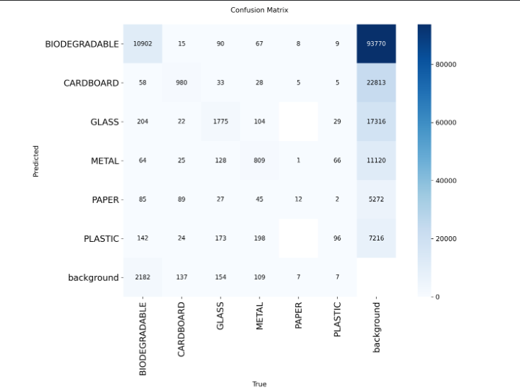

# YOLOv8 Waste Detection

Fine-tuned **YOLOv8s** to detect and label six kinds of waste (**biodegradable, cardboard, glass, metal, paper, plastic**) as a building block for automated sorting and recycling, then traced its weak spots back to class imbalance and look-alike materials.

  

**Overall validation results:** precision **0.622** · recall **0.493** · mAP50 **0.555** · mAP50-95 **0.380**

---

## Contents

- [Setup](#setup)
- [Results](#results)
- [Tested on new photos](#tested-on-new-photos)
- [Training](#training)
- [What we learned](#what-we-learned)
- [Run it yourself](#run-it-yourself)
- [Credits](#credits)

## Setup

| | |
|---|---|
| **Model** | YOLOv8s (11.2M parameters), fine-tuned from COCO-pretrained weights |
| **Dataset** | [Garbage Detection – 6 Waste Categories](https://www.kaggle.com/datasets/viswaprakash1990/garbage-detection) (Kaggle, YOLO format): 7,324 training and 2,098 validation images |
| **Training** | 75 epochs, batch 16, 640×640 images, AdamW (lr 0.001), early-stopping patience 20 |
| **Hardware** | Google Colab, Tesla T4 GPU (about 3.5 hours) |
| **Framework** | [Ultralytics](https://docs.ultralytics.com) |

## Results

Per-class scores on the validation set:

| Class | Precision | Recall | mAP50 | mAP50-95 | Instances |
|---|---:|---:|---:|---:|---:|
| Glass | 0.871 | 0.708 | **0.813** | 0.598 | 2,380 |
| Metal | 0.794 | 0.628 | 0.709 | 0.472 | 1,360 |
| Cardboard | 0.759 | 0.517 | 0.635 | 0.483 | 1,292 |
| Biodegradable | 0.825 | 0.478 | 0.632 | 0.358 | 13,637 |
| Plastic | 0.408 | 0.505 | 0.460 | 0.300 | 214 |
| Paper | 0.077 | 0.121 | **0.079** | 0.070 | 33 |
| **All** | **0.622** | **0.493** | **0.555** | **0.380** | |

## Tested on new photos

To see how the model handles images it had never seen, we ran it on photos from the web at a 0.25 confidence threshold.

<table>
  <tr>
    <td width="50%" valign="top">
      
       <b>🟡 Mostly right.</b> Plastic bag → <b>plastic 0.84</b>. The paper bag came back as <b>cardboard 0.77</b>, with a second box on its handle: the paper/cardboard confusion in action.
    </td>
    <td width="50%" valign="top">
      
       <b>🟡 Mostly right.</b> Glass bottle → <b>glass 0.92</b>. The clear plastic bottle was also boxed as glass, and only its cap was called <b>plastic 0.84</b>.
    </td>
  </tr>
  <tr>
    <td valign="top">
      
       <b>🟢 Works.</b> 15 <b>biodegradable</b> detections on watermelon and produce in a cluttered pile, the class with the most training data. A plate was picked up at low confidence.
    </td>
    <td valign="top">
      
       <b>🟡 Over-predicts.</b> 35 <b>metal</b> boxes. The cans are right, but the green glass bottle and the plastic bottle were called metal too.
    </td>
  </tr>
  <tr>
    <td valign="top">
      
       <b>🔴 Over-predicts.</b> 13 <b>cardboard</b> boxes on a busy, textured background, many on items that aren't cardboard. Matches the background false positives in the confusion matrix.
    </td>
    <td valign="top">
      
       <b>🔴 Weak.</b> Newspapers → <b>paper 0.30–0.31</b>, a folder → <b>glass 0.26</b>, and the cardboard stack missed. Paper had only 33 validation examples.
    </td>
  </tr>
</table>

Test photos were collected from the web for evaluation only; watermarks belong to their owners.

## Training

All losses fell steadily, and precision, recall, and mAP climbed fast in the first 20–30 epochs before flattening over the last 15–20. Early stopping never triggered, and mAP50-95 stayed within 0.373–0.378 for epochs 70–75, so the model had converged and more epochs would not have helped much.

The confusion matrix shows the main failure mode: every class has a large number of **background false positives** (the model predicts an object where there isn't one), and paper is almost never detected correctly.

## What we learned

- **The data mattered more than the model.** Paper had only 33 validation instances, over 400 times fewer than biodegradable, and its mAP50 was 0.079. The classes the model learned well were the ones with enough examples.
- **Look-alike classes get confused.** Cardboard and paper, and plastic and glass, were often mixed up, on top of the class imbalance.
- **The model over-predicts on cluttered scenes.** Busy, textured backgrounds produced far more boxes than there were objects, both in the confusion matrix and in the test photos above.
- **Next step:** a more balanced dataset, or more samples for paper and plastic, would help more than further tuning.

## Run it yourself

The whole pipeline is in [`yolov8_waste_detection.ipynb`](yolov8_waste_detection.ipynb), with its outputs saved.

1. Open the notebook in [Google Colab](https://colab.research.google.com/) and switch the runtime to a **T4 GPU**.
2. Run the cells in order. The notebook:
   - installs `ultralytics` and `kagglehub`
   - downloads the dataset from Kaggle with `kagglehub` (no manual download needed)
   - writes a `data.yaml` with the six class names and the train/val/test paths
   - fine-tunes `yolov8s.pt` for 75 epochs and evaluates on the validation set
3. To test on your own photos, put them in a Google Drive folder and set `my_images_dir` in the last cell to that folder.

Training takes about 3.5 hours on a T4. The best weights are saved to `runs/detect/garbage_train/weights/best.pt`.

## Credits

- **Team:** Gabriel Capacio, Gabriel Manjares, Emmanuel Subido
- **Dataset:** [Garbage Detection – 6 Waste Categories](https://www.kaggle.com/datasets/viswaprakash1990/garbage-detection) by viswaprakash1990, originally exported from Roboflow
- **Model and training framework:** [Ultralytics YOLOv8](https://docs.ultralytics.com)
